<div align=center>

</div>


# Python code for the UKRAA PicoMuon
[](/LICENSE)


Set of Python code to run on a RPi4/5 to get, process and present data from the UKRAA PicoMuon detector

This software was written to suit a specific set-up, feel free to use as you see fit.


Instructions for setting up a Raspberry Pi4/5 are included in the **docs** folder

---

&nbsp;
<!-- =============================================================================== --> 
### Can I update to latest version?

There is a section on updating your software to the latest version at the bottom of this README.

&nbsp;

---

&nbsp;
<!-- =============================================================================== --> 
### Where is my detector?

Plug your detector into any of the RPi USB ports - I normally use the blue ports (USB3).

1. Open a terminal window and type the following command and press enter
```
ls /dev/tty*
```

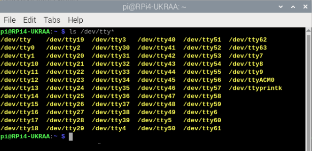

&nbsp;

2. You are looking for **/dev/ttyACM0** - this is on the right hand side of the screen shot above.

&nbsp;

3. This is the USB address for your attached detector - if you have more than one detector attached you may see **/dev/ttyACM1** etc.

&nbsp;

4. If you do not see **/dev/ttyACM0**, then unplug and plug the detector back in and try again.

&nbsp;

5. As long as you see **/dev/ttyACM0** then you do not have to make any changes to the python scripts, because they are looking for **ACM0**.

&nbsp;

---

&nbsp;
<!-- =============================================================================== --> 
## Install the software onto your RPi

1. Log into your Raspberry Pi4/5 using VNC.

&nbsp;

2. Open a terminal window, type the following command and press enter
```
git clone https://github.com/UKradioastro/UKRAA_PicoMuon
```

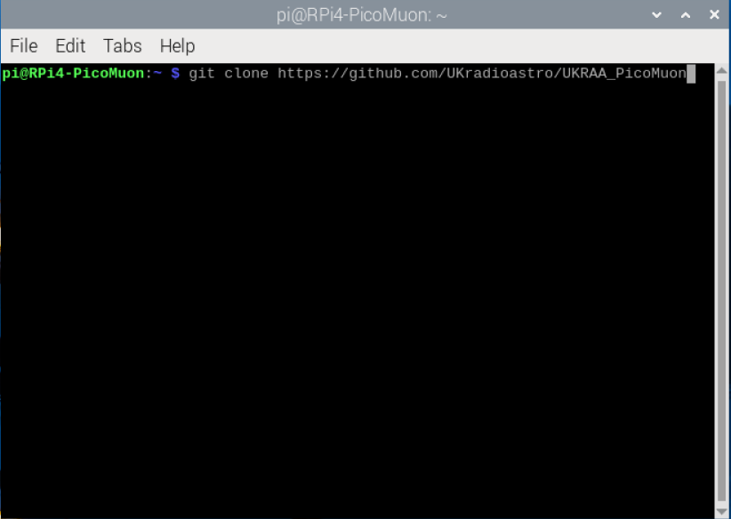

This downloads the code into a `UKRAA_PicoMuon` directory under the current user's home directory.

---

&nbsp;
<!-- =============================================================================== --> 
## Using the code

The raw data collector resolves serial settings from `config/USB.ini`, with support for stable `/dev/serial/by-id/` device paths configured via `python3 scripts/ConfigureUSB.py` (defaulting gracefully to `/dev/ttyACM0`). The installer uses the account that invoked `sudo`, so the software does not require a user named `pi`. Python and gnuplot scripts resolve paths from the installation directory.

**GetDataRaw.py** is run as the systemd service `PicoMuon.service`. Daily processing and plotting are run by a managed root crontab entry, with jobs executed as the installing user.

---

&nbsp;
<!-- =============================================================================== --> 
## Install the software onto your RPi


1. Open a terminal window and type the following command and press enter
```
cd ~/UKRAA_PicoMuon
```

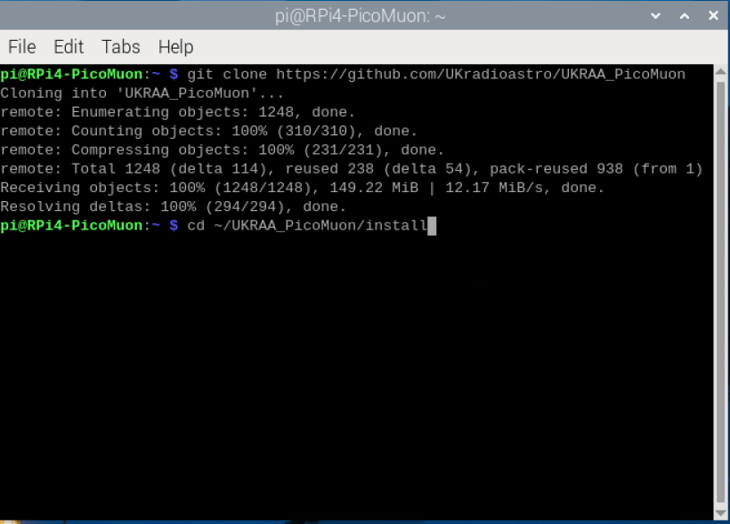

This takes you to the root of your cloned repository.


2. Type the following command and press enter
```
sudo bash install/install.sh
```

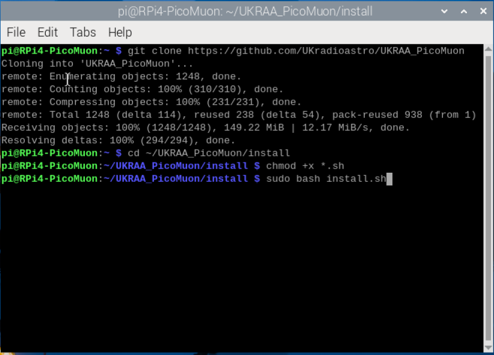

The installer installs the required packages, configures the collector service for your account, and replaces only the PicoMuon block in root's crontab. Daily processing starts at 01:15 local time; until Phase 2 replaces the legacy processing, it can take many hours to finish.

---

&nbsp;
<!-- =============================================================================== --> 
## What does the code do?

The code receives the event data from the UKRAA PicoMuon detector via serial over the supplied USB cable and stores the event data to the raw data folder:

The raw data will be processed overnight, via CRON, to get counts per minute, the frequency of the counts per minute and the frequency of the adc values for your previous day's data.

Processed products are stored directly under `data/` in their own folders (for example, `data/cpm/`, `data/day/`, and `data/adc/`); they are no longer nested under `data/processed/`. Files have a column header. Processed products also contain metadata comments, described below.

### Observation and legacy detector configuration

The installer creates `config/legacy.ini` and `config/user.ini` from the templates in `install/`, without overwriting existing values. For a manual upgrade, copy `install/legacy.ini.example` and `install/user.ini.example` to those configuration paths if they do not already exist. Stop collection before upgrading, configure the files, then restart the service.

**Check all four values in `config/legacy.ini` against your detector's actual settings before collecting data.** The example values are not a calibration or an automatic measurement. The collector accepts either:

```text
Event,EventCount,ADC,Elapsed_ms,Dead_ms,Temp_C,Pres_hPa,DetectorName
Event,EventCount,ADC,Elapsed_ms,Dead_ms,Temp_C,Pres_hPa,DetectorName,threshold_top,reset_top,threshold_bottom,reset_bottom
```

When the detector provides all four settings, those values take precedence. When it omits all four, the collector reads them from `[legacy]` in `config/legacy.ini`. Values must be non-negative integers in the firmware's native units; no unverified upper limit or threshold/reset relationship is imposed. Partial or invalid setting suffixes are rejected, not silently replaced. A missing or invalid legacy configuration stops collection with a logged error when an old-format event needs it. New-format detectors do not require this file.

Use CSV quoting if a detector name contains commas, particularly a numeric suffix. A limited compatibility path accepts historic unquoted names such as `MyDetector,Unit1`, but an unquoted numeric suffix is ambiguous with partial settings and is rejected. Stored names are CSV-escaped.

Fill in `config/user.ini` with information you are willing to share:

- Station identifier, name, location, decimal-degree latitude/longitude (north/east positive), coordinate datum, and altitude in metres with its height reference.
- Observer name and optional public identifier (for example ORCID).
- Detector model, firmware version, settings units, calibration reference/date, orientation, scintillator dimensions, detector separation, shielding, and installation notes.

Blank values mean unspecified, not zero. Latitude and longitude must be finite numbers within their geographic ranges; altitude must be finite. `observatory_tz` describes the site timezone (for example `Europe/London`); recorded timestamps remain UTC. **Non-empty public fields, including names and coordinates, are embedded in data files.** Choose location precision accordingly. `observer_email` is private contact information and is never copied into raw or processed metadata. No uploading is implemented.

The collector saves a snapshot when these public details, the detector name, the settings, or their source change. Configuration files are reread for each event, so subsequent events use edits without requiring a restart. Metadata is emitted again in each new daily file. This preserves what was known at collection time rather than applying today's settings or location to older observations.

### Phase 2a development: named-detector collection pilot

**This is the first Phase 2a milestone, not a production multi-detector release.**
Leave the working RPi's `[usb]` configuration unchanged. Multi-detector
daily/period processing, plotting, web publishing, service migration and
historical-data mapping are still pending. See the
[implementation status and deferred work](docs/implementation-plan.md#phase-2a--concurrent-multi-detector-support-before-phase-3).
The installer and processing/plot entry points refuse named mode rather than
mixing detector output. Do not run the installer against a pilot configuration.

For development, prepare a separate, empty pilot copy from the updated code,
without copying or moving the production archive:

```bash
cd ~/UKRAA_PicoMuon
PILOT=$(mktemp -d "$HOME/UKRAA_PicoMuon-pilot.XXXXXX")
cp -a scripts install VERSION "$PILOT/"
mkdir -p "$PILOT/config"
cp install/USB.ini.example "$PILOT/config/USB.ini"
cp install/legacy.ini.example "$PILOT/config/legacy.ini"
cp install/user.ini.example "$PILOT/config/user.ini"
echo "$PILOT"
```

Register each physical unit using its current device path. Registration resolves
the stable by-id alias and records its udev identity without probing the serial
stream. Check that the printed path/identity belongs to the intended unit.
The second registration preserves the first and the existing `[usb]` section:

```bash
PICOMUON_BASE_PATH="$PILOT" python3 "$PILOT/scripts/ConfigureUSB.py" \
    --register East --device /dev/ttyACM0
PICOMUON_BASE_PATH="$PILOT" python3 "$PILOT/scripts/ConfigureUSB.py" \
    --register West --device /dev/ttyACM1
```

Use `--serial-port /dev/serial/by-id/...` if alias discovery is unavailable.
Labels retain case, start with a letter/digit and contain at most 16
letters/digits, underscores or hyphens. `single` and `rejected` are reserved.
Duplicate labels ignoring case, duplicate USB identities and aliases resolving
to the same device are rejected. One or more entries in `[detectors]` selects
named mode; even one named unit requires `--detector LABEL`. An optional
`--detector-name "known current name"` enables cross-unit name checks; USB
identity, not the mutable detector name, remains authoritative.

Edit the pilot's `config/legacy.ini` to add **complete, correct** sections for
each old-firmware unit, for example:

```ini
[legacy:East]
threshold_top = 200
reset_top = 100
threshold_bottom = 200
reset_bottom = 100

[legacy:West]
threshold_top = 250
reset_top = 120
threshold_bottom = 250
reset_bottom = 120
```

These are examples, not measurements. Named units do **not** inherit from
`[legacy]`, another label or `[DEFAULT]`; a missing/incomplete section stops that
collector when an old-format event arrives. Detector-provided settings take
precedence, so new firmware does not require a legacy section. The existing
single-detector mode continues to use `[legacy]`. Public observation details
remain common to the pilot installation for now.

Before live testing, stop any production collector using either device
(`PicoMuon.service`, `PicoMuonACM0.service` or a manually started process).
**Never run production and pilot collectors against the same serial port.**
This introduces an intentional gap in production capture; pilot data will not
automatically merge back into the archive. Keep the test short and preserve
the pilot data for any later explicit migration.

In one terminal, run East in the foreground, saving its log output:

```bash
mkdir -p "$PILOT/logfiles/detectors/East" "$PILOT/logfiles/detectors/West"
PICOMUON_BASE_PATH="$PILOT" python3 -u "$PILOT/scripts/GetDataRaw.py" --detector East \
    >> "$PILOT/logfiles/detectors/East/log-PicoMuon.txt" \
    2>> "$PILOT/logfiles/detectors/East/log-error.txt"
```

In a second terminal, set `PILOT` to the same printed directory and run the
equivalent command with `West`. Use Ctrl+C to stop each foreground collector
before restarting the production service. Expected pilot outputs:

- `data/raw/East/YYYY/YYYY-MM/YYYY-MM-DD.txt` and the equivalent West path.
- `data/raw/East/rejected/YYYY-MM-DD.txt`, independently for each unit.
- `data/status/East/current.json` and `data/status/West/current.json`.
- A stable `detector_label` and the correct unit's fallback settings in raw
  metadata. A reported detector-name change does not change the output folder.

An identity mismatch is logged and retried with backoff **without opening the
serial port**. A name registered to another unit stops collection with an
explicit cable-swap error. Serial access is exclusive; disconnecting one unit
must not stop the other. Reconnecting/swapping ACM enumeration must still use
the same stable aliases and folders. Two units may require a powered USB hub.

`install/PicoMuon@.service` supplies a future per-label service template with
separate log paths and conflicts with the old single-collector services, but is
deliberately **not installed or enabled automatically** in this milestone.
Do not rename labels, move raw files or adopt pilot data into production yet:
safe mapping, same-day transitions and processing isolation are the next work.
Raw data is never migrated by registration.

Run `python3 -m unittest discover -s tests -p 'test_*.py'` from the updated
repository. Named-detector tests use isolated data and simulated streams; the
POSIX exclusive-access test uses a local pseudo-terminal, not your detector.

### Raw event columns

Raw files have this header:

```text
RPiTimestamp,Event,EventCount,ADC,Elapsed_ms,Dead_ms,Temp_C,Pres_hPa,DetectorName,threshold_top,reset_top,threshold_bottom,reset_bottom
```

| Column | Meaning |
| --- | --- |
| RPiTimestamp | Raspberry Pi UTC timestamp when the event was received |
| Event | Top (`T`), bottom (`B`), or coincidence/muon (`C`) event |
| EventCount | Detector's event counter |
| ADC | Event pulse ADC value |
| Elapsed_ms | Detector's reported elapsed-time counter, in milliseconds |
| Dead_ms | Detector's reported dead-time counter, in milliseconds |
| Temp_C | Detector temperature in degrees Celsius |
| Pres_hPa | Detector pressure in hectopascals |
| DetectorName | Detector identification string |
| threshold_top | Top detector threshold setting |
| reset_top | Top detector reset setting |
| threshold_bottom | Bottom detector threshold setting |
| reset_bottom | Bottom detector reset setting |

New events always contain these 13 columns, including the Raspberry Pi timestamp. Readers accept old 9-column events and the new 13-column events, with or without headers. Existing event bytes are not rewritten: on the first new write to an old-format or headerless file, the collector appends the extended column header and a metadata snapshot before new events. Such a transition file can therefore contain both row widths and repeated headers. PicoMuon readers ignore both header formats and `#` comment lines.

### Metadata in processed and shared data

Metadata belongs in a labelled preamble, **not in the column names**. CPM, day, ADC, hourly and period products include a line beginning `# picomuon_metadata: ` containing a JSON object, followed by the ordinary, unchanged CSV column header. For example, a compact daily file can begin:

```text
# picomuon_metadata: {"schema_version":1,"time_basis":"UTC","segments":[{"detector_name":"Detector","settings":{"threshold_top":200,"reset_top":100,"threshold_bottom":200,"reset_bottom":100},"settings_source":"legacy.ini","observation":{},"first_event_utc":"2026-10-16 00:00:01.000000","last_event_utc":"2026-10-16 00:00:01.000000","event_count":1}]}
DateTime,Count_T,Count_B,Count_C
2026-10-16 00:00:00,0,0,1
```

Each consecutive configuration segment records the detector, all four settings, their source (`detector`, `legacy.ini` or `unknown`), public observation details, first/last event timestamps and event count. These timestamps bound observed events, not the precise instant a setting was changed. A file can contain multiple segments; do not assume one setting applies throughout a day, ADC spectrum or aggregate bin. Numerical products remain aggregated as before; use the raw events if you need to split them by configuration.

Period products carry the metadata of each available source day. `data/daily/summary.csv` keeps its ordinary header and places a metadata comment immediately before each day's row; reprocessing one day preserves the other days' metadata. Older files without capture-time metadata retain unknown settings/location: historical reprocessing does **not** guess from current INI files. Unknown settings are JSON `null`.

This keeps each shared file self-contained, including changes during the observation. Existing files gain processed metadata when reprocessed; no historical metadata can be recovered if it was never recorded. Gnuplot ignores `#` comments. For external readers, filter comment lines before CSV parsing, or use `pandas.read_csv(path, comment="#")`. The legacy processing scripts also accept these comments; existing non-empty outputs from their append-only workflow must be removed or archived before regeneration.

### Adding headers to historic and current raw files

Copy the revised scripts (including `picomuon_common.py`, both raw collectors, the raw readers, and `AddRawHeaders.py`) to the RPi first. Do not run this migration while a collector or another process is writing raw files.

From the installation directory, preview which files need a header:

```bash
cd ~/UKRAA_PicoMuon
python3 scripts/AddRawHeaders.py
```

Stop collection, then confirm it is stopped:

```bash
sudo systemctl stop PicoMuon.service
systemctl is-active PicoMuon.service
```

The status must be `inactive`. If the legacy `PicoMuonACM0.service` is running, stop that too. Also stop any manually launched collectors. Run the migration as the account that owns the data:

```bash
python3 scripts/AddRawHeaders.py --apply --collectors-stopped
```

`--collectors-stopped` is your confirmation, not an automatic service check. The migration includes today's file, historic files and detector-labelled subfolders under `data/raw/`. Files in `data/raw/rejected/` are excluded because malformed serial rows do not have a fixed column schema.

Each changed file gets a byte-exact `*.txt.pre-header.bak` backup alongside it. The original event bytes are preserved unchanged after the new header, and replacement is atomic per file. The migration chooses the old or extended header to match the first event; it does not add missing settings or invent historical metadata. Keep enough free disk space for the backups and a temporary copy of the largest file. Re-running skips files that already have either recognised header. If a backup already exists for a headerless file, the migration stops rather than overwriting it; investigate before retrying.

Only after the migration succeeds, restart collection and check it:

```bash
sudo systemctl start PicoMuon.service
systemctl is-active PicoMuon.service
head -n 2 "data/raw/$(date -u +%Y/%Y-%m/%F).txt"
```

The service should be `active`. If using a detector label (including the legacy `ACM0` layout), include that folder between `raw/` and the year in the last command. Raw data collection pauses during migration; no missed events can be recovered by this procedure. There is no need to reprocess data just because a header was added.

### Log format

New runtime entries use UTC timestamps and an aligned process name:

```text
2026-10-16 17:44:19 UTC : ProcessDaily.py            : Completed processing for 2026-10-15
2026-10-16 17:44:20 UTC : PlotDataWeekACM0.gp        : Skipped: no week product for 2026-10-15 (see period-processing entries)
2026-10-16 17:44:21 UTC : PlotDataDayACM0.gp         : ERROR: command failed (exit code 1)
```

- `logfiles/log-PicoMuon.txt` contains normal progress, completions, summaries and expected skips.
- `logfiles/log-error.txt` contains errors, warnings and command diagnostics.
- Python uses the shared logging functions in `scripts/picomuon_common.py`. Shell scripts use `scripts/logging.sh`, which also runs external commands, formats each output line and preserves failure exit codes. Already formatted lines are not prefixed a second time. Python tracebacks retain their details with the same prefix on every line.
- The collector service routes stdout/stderr to the two logs. Daily processing, reprocessing, plotting and cron use the shared command wrapper for the same routing, including gnuplot diagnostics.
- Plot Started/Completed/Skipped messages come from the shell wrapper rather than the gnuplot files. Missing week/month products are skipped; missing required daily products and non-zero gnuplot exits are failures. Failure counts and final exit statuses reflect these failures.
- Use `bash scripts/plots.sh [YYYY-MM-DD]` to run plots with logging. Reprocessing with `--plot` uses its requested end date for plot inputs, titles and time ranges.
- Historic log entries are not rewritten.

For a WinSCP update, upload the revised shell and Python scripts together with all six `PlotData*.gp` scripts; the plot scripts and wrapper must be updated together. Restart `PicoMuon.service` after updating `picomuon_common.py` so the running collector loads the revised logging helper. No raw-data migration or reprocessing is needed just for the logging update.

Three plots will be created:
* counts per minute
* frequency of counts per minute
* frequency of ADC values recorded

A request will be made to [NMDB](https://www.nmdb.eu/) via NEST to get the previous days recorded neutron count, this data will be overlaid onto the day / week / month % deviation counts per minute graphs.

These will appear as the required amount of data is recorded by the detector

A simple web server and web page is set up on your RPi so that you can view your detector's results on your desktop PC and/or smart phone when connected to your home network.

To access the webpage on your desktop PC or your smart phone…

1.	Open your preferred web application (Safari, Chrome, Firefox, etc.).

2.	In the search bar type the following and press enter
```
http://rpi4-UKRAA.local
```

This will take you to the web page for your detector, displaying yesterday’s events graphs.

NOTE: if you have a different **hostname** for your RPi, change the search bar entry to…

**http://_hostname_.local**

Where *hostname* is the hostname for your RPi setup.

---

&nbsp;
<!-- =============================================================================== --> 
## Check GetDataRaw.py is running

1. To check the **status** of your service, type the following command and press enter.
```
sudo systemctl status PicoMuon.service
```

&nbsp;

2. To **start** your service, type the following command and press enter.
```
sudo systemctl start PicoMuon.service
```

&nbsp;

3. To **stop** your service, type the following command and press enter.
```
sudo systemctl stop PicoMuon.service
```

&nbsp;

4. To **enable** your service, type the following command and press enter.
```
sudo systemctl enable PicoMuon.service
```

&nbsp;

5. To **disable** your service, type the following command and press enter.
```
sudo systemctl disable PicoMuon.service
```

&nbsp;

---

&nbsp;
<!-- =============================================================================== --> 
## Updating your software

1. Log into your Raspberry Pi4/5 using VNC.


2. Open your web browser, type the following command into the URL window and press enter
```
https://download-directory.github.io/?url=https%3A%2F%2Fgithub.com%2FUKradioastro%2FUKRAA_PicoMuon%2Ftree%2Fmain%2Fupdate
```

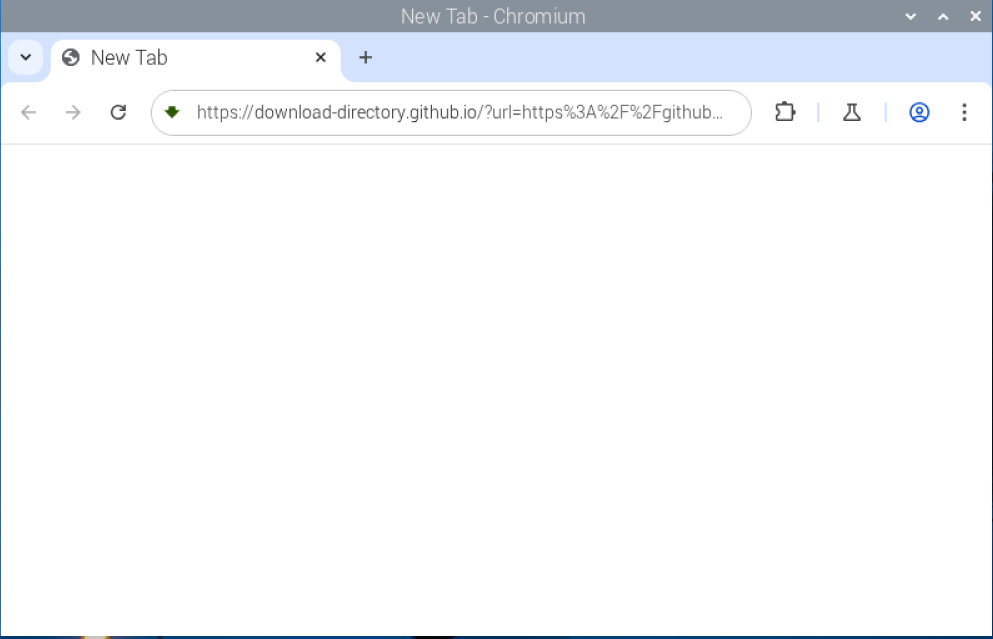

This will download a zip file of the updated code to your RPi **~/Downloads** folder.

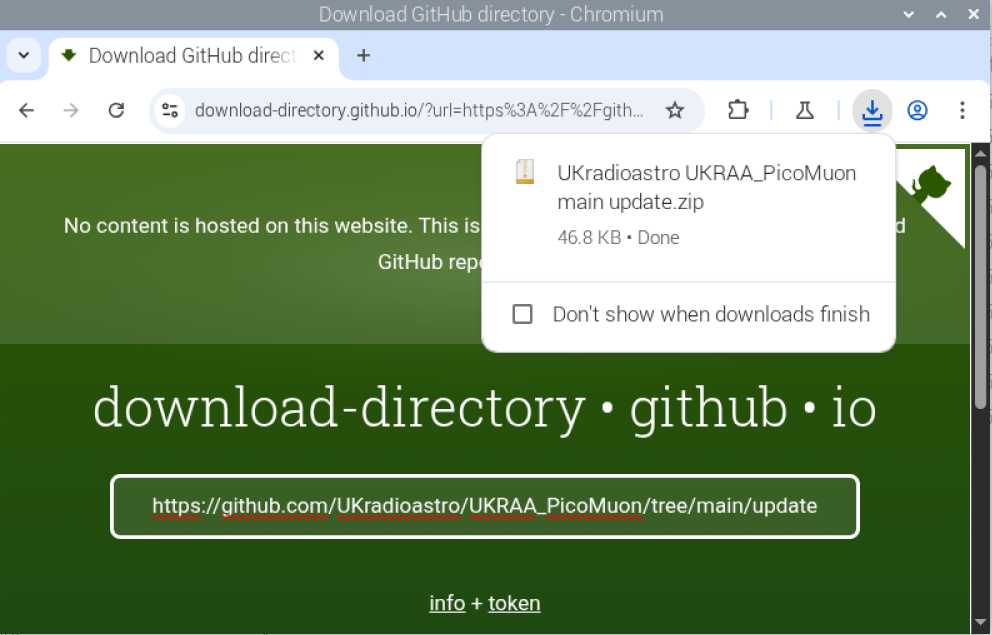

Close your web browser.


3. Open **File Manager** and navigate to **~/Downloads**. You should see the zip file you just downloaded.

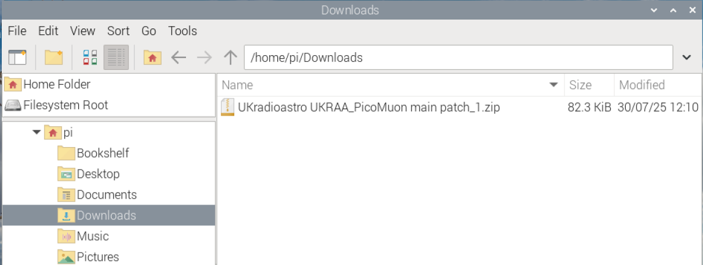

4. Double click on the downloaded zip file **UKradioastro UKRAA_PicoMuon main update.zip**.  This will open the RPi **xarchiver** utility.

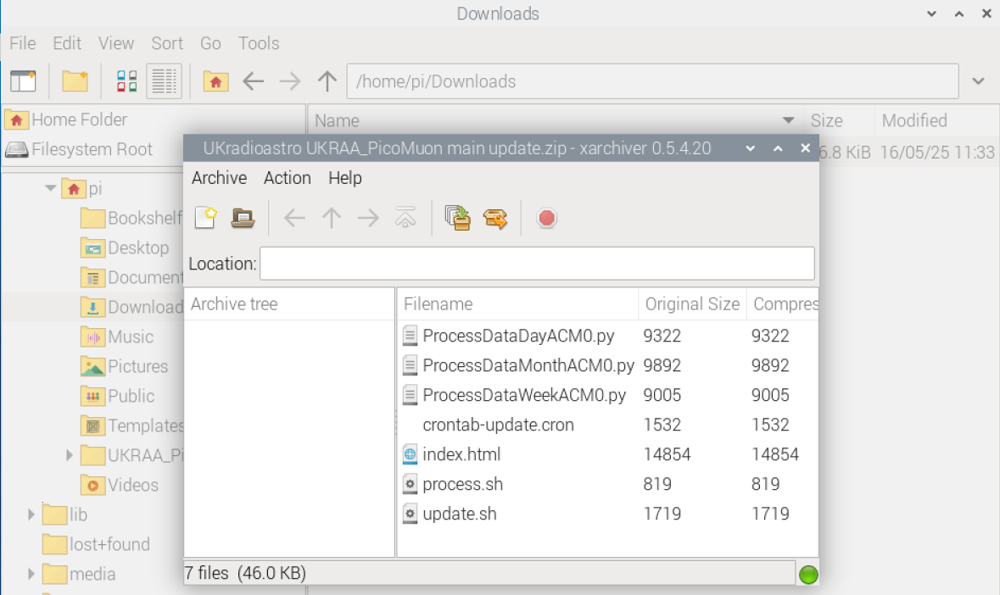

5. Now click on the **extract** icon on the menu ribbon.

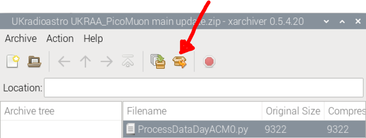

6. Change **Extract to:** from **/tmp** to **~/Downloads**, then click on the **Extract** button

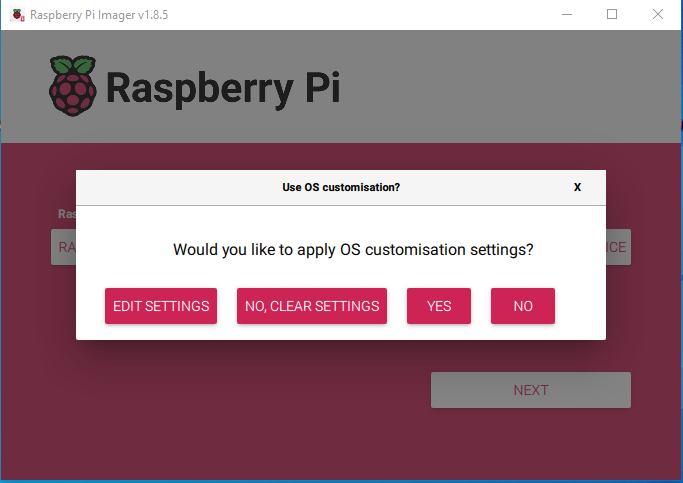

Close the RPi xarchiver utility.

7. You should now see a new unzipped folder in the Downloads folder

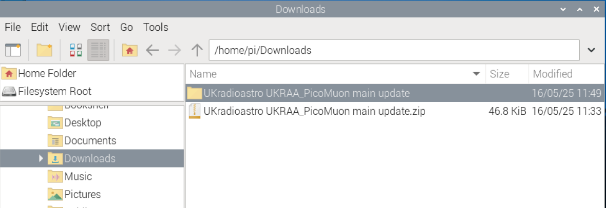

8. Select **UKradioastro UKRAA_PicoMuon main update** folder and rename **update** (Right click mouse to bring up function).

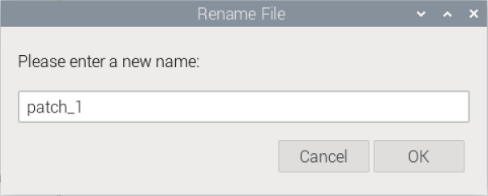

9. Select the **update** folder and copy (Right click mouse to bring up function).

10. Navigate to the PicoMuon directory, **~/UKRAA_PicoMuon**, and paste the **update** folder

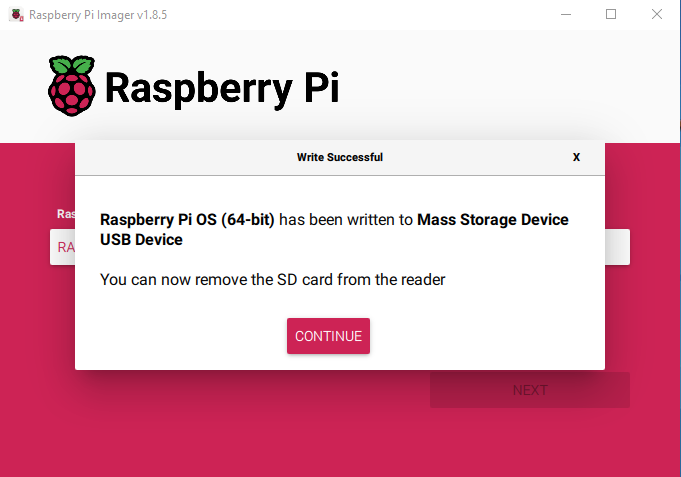

Close the **File Manager** window

11. Open a terminal window and type the following command and press enter
```
cd ~/UKRAA_PicoMuon/update
```

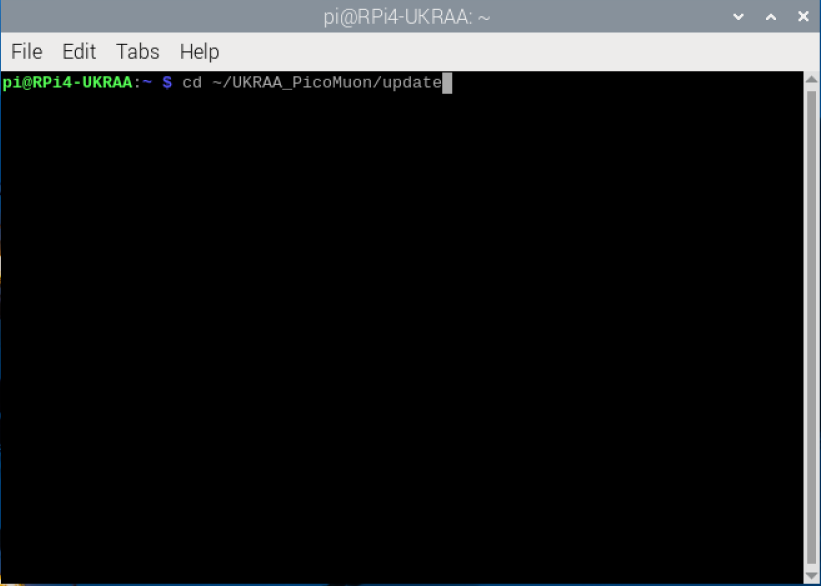

This will take you to the **update** directory inside **~/UKRAA_PicoMuon**

12. Type the following command and press enter
```
chmod +x *.sh
```

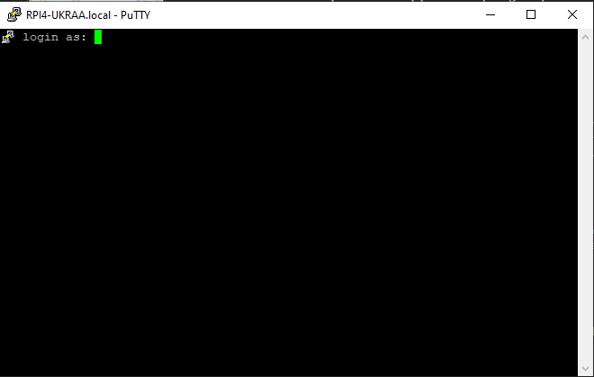

This will make the **update.sh** script executable.


13. Type the following command and press enter
```
sudo bash update.sh
```

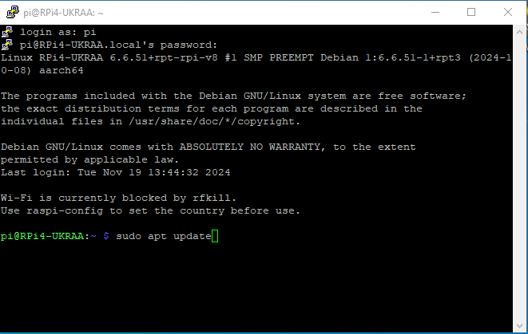

This will run the update script.

14. That's it!  You should see the following...

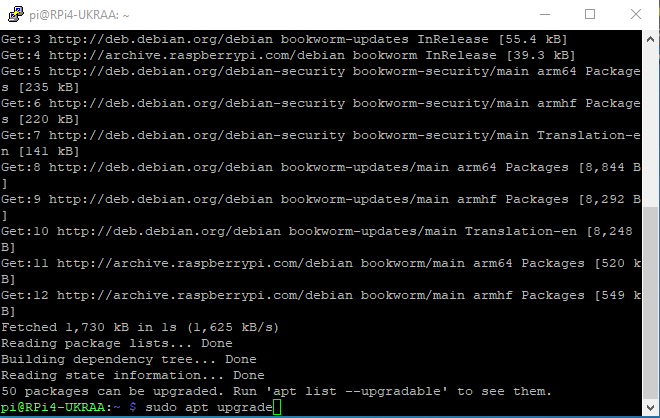

The updated code is now set; it will get the data from the detector, process yesterdays data, plot yesterdays data and post yesterdays plots to your intranet web page once per day, at 9.30am in the morning.

&nbsp;

---

&nbsp;
<!-- =============================================================================== --> 
### License

MIT License

Copyright (c) 2024 UKRAA

Permission is hereby granted, free of charge, to any person obtaining a copy
of this software and associated documentation files (the **Software**), to deal
in the Software without restriction, including without limitation the rights
to use, copy, modify, merge, publish, distribute, sublicense, and/or sell
copies of the Software, and to permit persons to whom the Software is
furnished to do so, subject to the following conditions:

The above copyright notice and this permission notice shall be included in all
copies or substantial portions of the Software.

THE SOFTWARE IS PROVIDED **AS IS**, WITHOUT WARRANTY OF ANY KIND, EXPRESS OR
IMPLIED, INCLUDING BUT NOT LIMITED TO THE WARRANTIES OF MERCHANTABILITY,
FITNESS FOR A PARTICULAR PURPOSE AND NONINFRINGEMENT. IN NO EVENT SHALL THE
AUTHORS OR COPYRIGHT HOLDERS BE LIABLE FOR ANY CLAIM, DAMAGES OR OTHER
LIABILITY, WHETHER IN AN ACTION OF CONTRACT, TORT OR OTHERWISE, ARISING FROM,
OUT OF OR IN CONNECTION WITH THE SOFTWARE OR THE USE OR OTHER DEALINGS IN THE
SOFTWARE.


---

&nbsp;
<!-- =============================================================================== --> 
### Contact us

Please send an e-mail to picomuon@ukraa.com